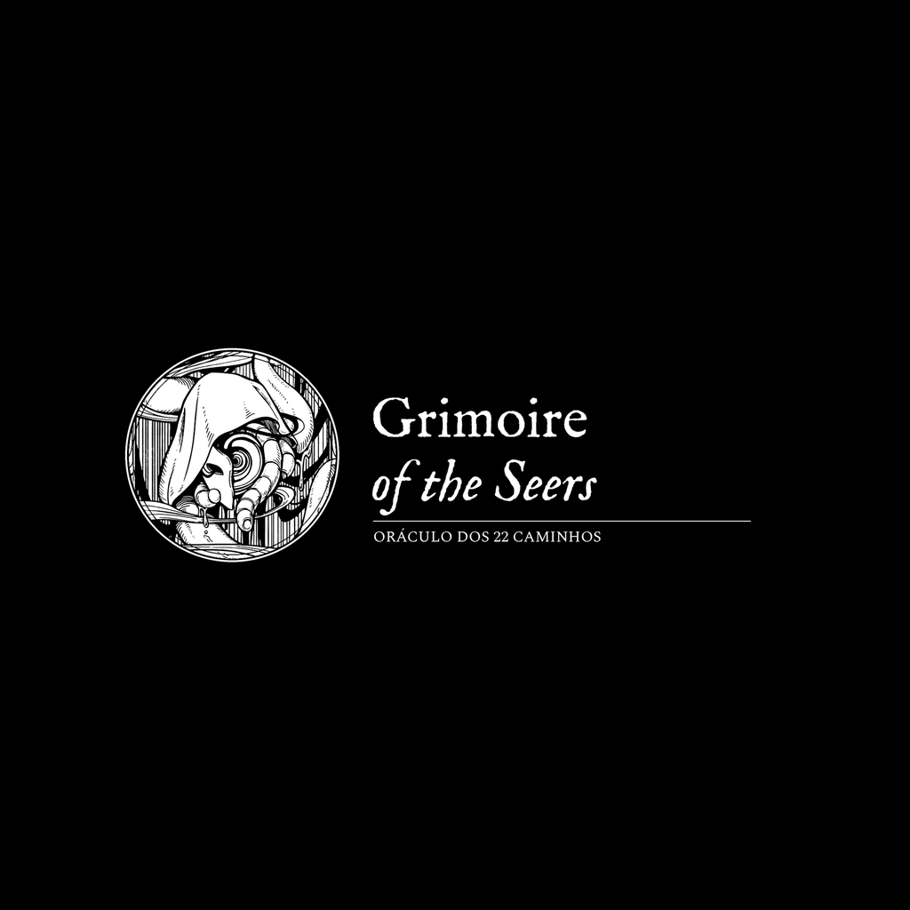
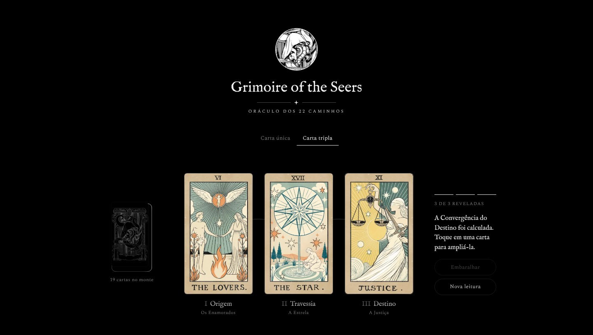
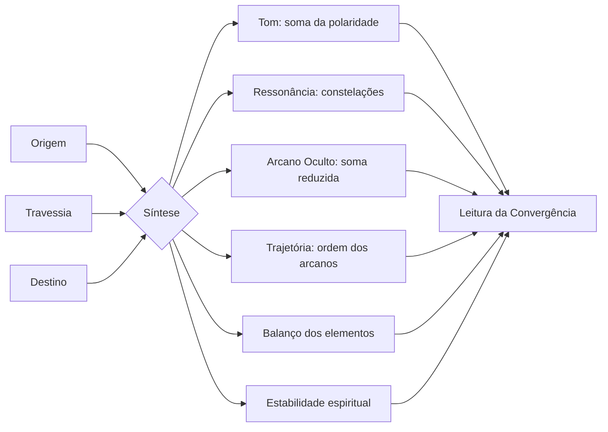
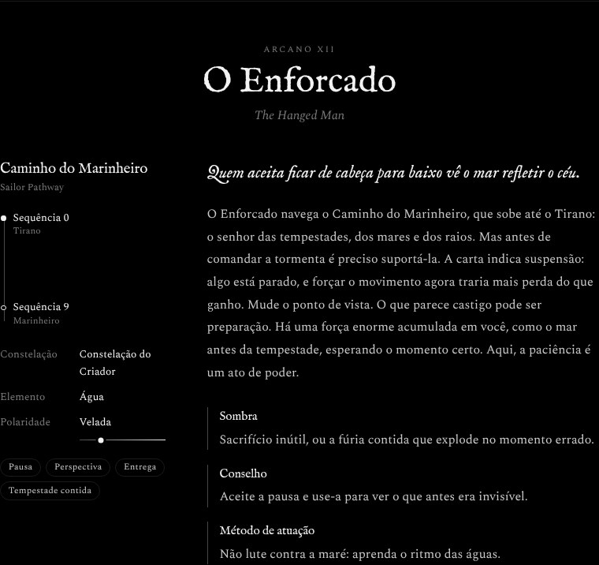
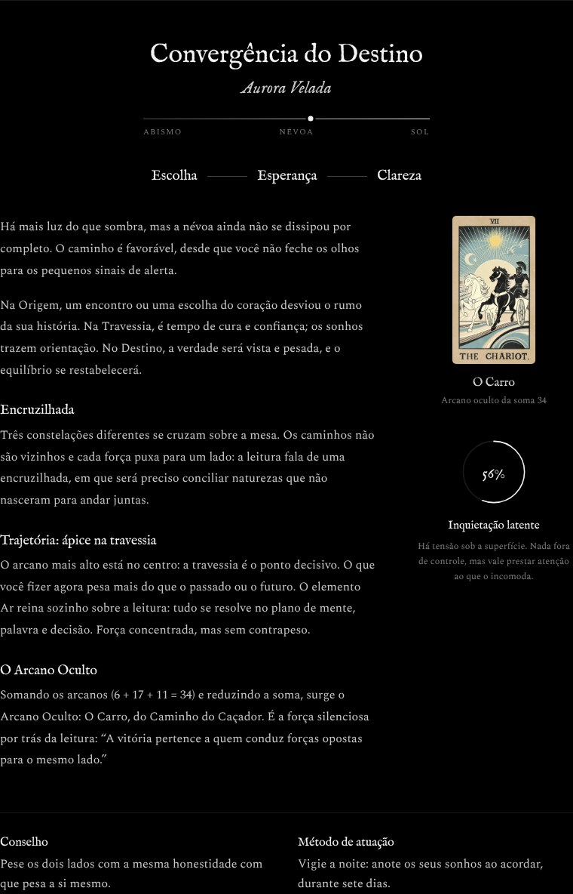
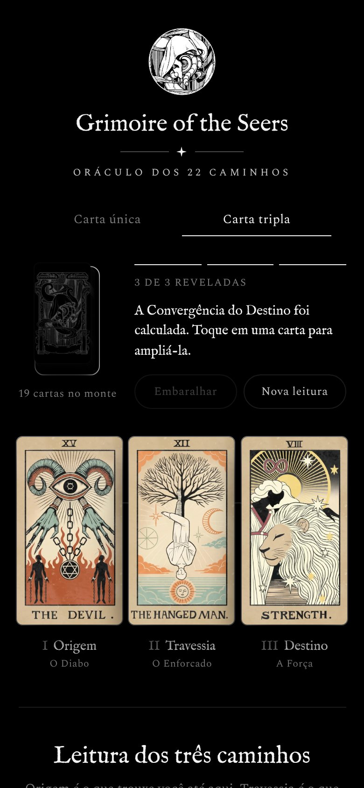

<p align="center">
  
</p>

<h1 align="center">Grimoire of the Seers<br><sub><sup><sup><sub>Copyright (©) 2026 Erik Pimenta e Clara Portes</sub></sup></sup></sub></h1>

<p align="center">
  Oráculo de tarô inspirado nos 22 Caminhos de <i>Lord of the Mysteries</i>. Cada Arcano Maior corresponde a um Caminho Beyonder, da Sequência 9 à Sequência 0.<br>
  Tire uma carta para uma resposta direta, ou três para calcular a Convergência do Destino: uma síntese automática das forças sorteadas.
</p>

<p align="center">
  
</p>

Feito com HTML5, CSS3 e JavaScript puro. Sem frameworks, sem build, sem dependências externas: as fontes estão no próprio repositório e o projeto funciona até offline.

## O que o Grimoire faz

- **Carta única**: sorteia um arcano, revela o Caminho correspondente e escreve no grimório uma leitura completa: essência, interpretação, sombra, conselho e método de atuação.
- **Carta tripla**: tira até três cartas em sequência (Origem, Travessia e Destino). Quando as três são reveladas, a Convergência do Destino é calculada na hora.
- **Mesa interativa**: monte com animação de embaralhar, voo da carta até a posição, giro 3D ao revelar, clarão de luz e fios finos ligando as cartas convergentes.
- **Iluminação**: monte e cartas inclinam em 3D com inércia e refletem a luz conforme o ponteiro. Toque em uma carta revelada para ampliá-la com a leitura completa.
- **Fluidez**: animações feitas só com `transform` e `opacity` (Web Animations API e `requestAnimationFrame`), sem travar a página. É possível tirar várias cartas seguidas sem esperar a anterior pousar.
- **Atalhos de teclado**: `Espaço` tira uma carta, `1`, `2` e `3` revelam cada posição e `N` inicia uma nova leitura. Clicar na próxima posição vazia da mesa também tira uma carta.
- **Painel de controle**: barra de progresso das cartas reveladas, instrução do próximo passo e botões de embaralhar e de nova leitura, ao lado das cartas.
- **Visual**: design minimalista em preto e branco, com fundo preto, linhas finas e tipografia serifada. As cartas são o único ponto de cor. O cabeçalho traz o emblema do grimório centralizado, com o nome e o subtítulo logo abaixo.
- **Sorteio justo**: embaralhamento Fisher–Yates com `crypto.getRandomValues`, sem repetir cartas na mesma leitura.
- **Responsivo e acessível**: adaptado para computador, tablet e celular, navegável por teclado, com anúncios para leitores de tela e respeito a `prefers-reduced-motion`.

## Como a Convergência do Destino é calculada



1. **Tom da leitura**: cada arcano tem uma polaridade entre sombra (−2) e luz (+2). A soma define o tom: Ascensão Solar, Aurora Velada, Equilíbrio Cinzento, Crepúsculo ou Descida ao Abismo.
2. **Ressonância**: os Caminhos se agrupam em constelações de caminhos vizinhos. Três cartas da mesma constelação geram uma *convergência absoluta*; duas geram *caminhos vizinhos*; nenhuma, uma *encruzilhada*.
3. **Arcano Oculto**: os números das três cartas são somados e reduzidos até caber entre 0 e 21. O arcano resultante é a força silenciosa por trás da leitura, e ganha ênfase se coincidir com uma carta revelada.
4. **Trajetória**: a ordem dos números indica jornada ascendente, descendente, com ápice ou com vale na travessia.
5. **Elementos e estabilidade**: o elemento dominante (Fogo, Água, Ar ou Terra) e o risco de cada Caminho resultam no índice de estabilidade espiritual, que vai de *Espírito estável* a *À beira da perda de controle*.

Por fim, as frases de posição de cada carta são costuradas numa narrativa única, com o conselho do Destino e o método de atuação da Travessia.

## Os 22 Caminhos

| Arcano | Carta | Caminho (Sequência 9) | Sequência 0 | Constelação |
|:---:|---|---|---|---|
| 0 | O Louco | Vidente | O Tolo | Mistério |
| I | O Mago | Aprendiz | Porta | Mistério |
| II | A Sacerdotisa | Suplicante de Segredos | Enforcado | Criador |
| III | A Imperatriz | Plantador | Mãe | Origem |
| IV | O Imperador | Advogado | Imperador Negro | Ordem |
| V | O Hierofante | Leitor | Torre Branca | Criador |
| VI | Os Enamorados | Assassino | Demônia | Calamidade |
| VII | O Carro | Caçador | Sacerdote Vermelho | Calamidade |
| VIII | A Força | Guerreiro | Gigante do Crepúsculo | Crepúsculo |
| IX | O Eremita | Bisbilhoteiro dos Mistérios | Eremita | Saber |
| X | A Roda da Fortuna | Monstro | Roda da Fortuna | Roda Solitária |
| XI | A Justiça | Espectador | Visionário | Criador |
| XII | O Enforcado | Marinheiro | Tirano | Criador |
| XIII | A Morte | Coletor de Cadáveres | Morte | Crepúsculo |
| XIV | A Temperança | Erudito | Paragon | Saber |
| XV | O Diabo | Criminoso | Abismo | Queda |
| XVI | A Torre | Prisioneiro | Acorrentado | Queda |
| XVII | A Estrela | Insone | Trevas | Crepúsculo |
| XVIII | A Lua | Boticário | Lua | Origem |
| XIX | O Sol | Bardo | Sol | Criador |
| XX | O Julgamento | Árbitro | Justiceiro | Ordem |
| XXI | O Mundo | Saqueador | Erro | Mistério |

O mapeamento é autoral. Onde a obra dá pistas, elas foram seguidas: os codinomes do Clube do Tarô (Louco, Mago, Justiça, Enforcado, Sol, Estrela, Lua, Eremita, Julgamento) e os nomes da Sequência 0 que já são arcanos (Roda da Fortuna, Morte, Eremita). Os demais foram escolhidos pelo tema de cada carta.

## Como rodar

Não há instalação. Escolha uma das opções:

**Abrir direto**: dê dois cliques em `abrir.bat` (Windows) ou em `index.html`.

**Servidor local** (recomendado para testar como em produção):

```bash
git clone https://github.com/ravelroot/Grimoire-of-the-Seers.git
cd Grimoire-of-the-Seers
python -m http.server 8000
```

Depois acesse `http://localhost:8000`.

**GitHub Pages**: em **Settings › Pages**, escolha a branch `main` e a pasta `/ (root)`. O site fica disponível em `https://ravelroot.github.io/Grimoire-of-the-Seers/`.

## Telas

| Leitura de carta única | Convergência do Destino |
|:---:|:---:|
|  |  |

| Celular |
|:---:|
|  |

## Estrutura

```
Grimoire-of-the-Seers/
├── abrir.bat             # abre o index.html no navegador padrão (Windows)
├── index.html            # mesa de leitura, grimório e diálogo da carta
├── css/
│   └── style.css         # tema preto e branco, giro 3D e responsividade
├── js/
│   ├── cards.js          # 22 arcanos, caminhos, constelações e textos
│   ├── oracle.js         # embaralhamento e cálculo da Convergência (funções puras)
│   └── app.js            # interface: monte, voo, revelação e grimório
├── assets/
│   ├── cards/            # 22 cartas + verso (WebP)
│   ├── fonts/            # IM Fell English e Spectral (OFL)
│   ├── logo.png          # emblema do cabeçalho do site
│   └── favicon.png
└── docs/images/          # logo e capturas de tela do README
```

## Personalizar

- **Textos das cartas**: edite o objeto do arcano em `js/cards.js`. Os campos `origem`, `travessia` e `destino` são as frases usadas na narrativa da Convergência.
- **Peso de cada carta na síntese**: ajuste `luz` (−2 a +2) e `risco` (0 a 30) em `js/cards.js`.
- **Regras da Convergência**: faixas de tom, bônus de ressonância e cálculo da estabilidade ficam em `js/oracle.js`.
- **Ilustrações**: substitua os arquivos em `assets/cards/` mantendo os nomes e a proporção 9:16.

## Parceria

Projeto desenvolvido em parceria com parceira de projetos e de vida **Clara Portes** ([@Violet-star](https://github.com/Violet-star)).

## Aviso

Projeto de fã, sem fins comerciais e sem vínculo com o autor ou os editores de *Lord of the Mysteries*. Os nomes dos Caminhos pertencem à obra original. As ilustrações das cartas e do verso pertencem aos seus respectivos autores. As leituras são para entretenimento e reflexão.

## Licença

Código sob [MIT](LICENSE). Use, copie, altere e distribua à vontade. As fontes seguem a SIL Open Font License; as ilustrações não estão incluídas na licença MIT.
